# Hướng dẫn sử dụng Site Test Report

Lập biên bản thí nghiệm (BBTN) máy biến áp theo QĐ 1901/QĐ-EVNNPT: nhập số liệu, app tự quy đổi, so với xuất xưởng / lịch sử và đánh giá; xuất BBTN Word.

> **Mở hướng dẫn:** nút **?** trên thanh công cụ hoặc phím **F1** — app mở đúng phần của trang đang xem. Nút **Mở trang →** trong hướng dẫn nhảy thẳng tới trang đó. Ảnh minh họa dùng **số liệu giả**.

## Bản đồ chức năng

Ký hiệu ở cột đầu giống ký hiệu trên thanh điều hướng bên trái.

| | Trang | Dùng để | |
|---|---|---|---|
| `HT` | [Nhập hiện trường](#ht-nhap-hien-truong) | Nhập từng ô cỡ lớn trên điện thoại, có giọng nói | [Mở →](#app:field) |
| `XX` | [Số liệu xuất xưởng](#xx-so-lieu-xuat-xuong) | Cây Trạm → Ngăn → Thiết bị; nhập test report làm giá trị khởi đầu | [Mở →](#app:factory) |
| `NB` | [Nhập BBTN cũ](#nb-nhap-bbtn-cu) | Đưa BBTN .docx / .pdf cũ vào CSDL cho xu hướng | [Mở →](#app:importReport) |
| `3D` | [Mô hình 3D MBA](#3d-mo-hinh-3d-mba) | Bấm bộ phận / sứ từng pha để mở ô nhập | [Mở →](#app:model3d) |
| `1–12` | [Các hạng mục thí nghiệm](#cac-hang-muc-thi-nghiem) | Hướng dẫn đo, nhập số liệu, đánh giá từng hạng mục | [Mở mục 3 →](#app:ir) |
| `PL` | [Phụ lục BBTN](#pl-phu-luc-bbtn) | Chụp sóng OLTC, SFRA, dầu, DFR sứ đính kèm | [Mở →](#app:appendix) |
| `↗` | [Xu hướng](#xu-huong) | Đồ thị các lần đo, dự báo | [Mở →](#app:trend) |
| `Σ` | [Tổng hợp và kết luận](#tong-hop-va-ket-luan) | Rà kết quả, điền kết luận tự động | [Mở →](#app:summary) |
| `DB` | [Cơ sở dữ liệu (CSDL)](#db-co-so-du-lieu-csdl) | Đăng nhập, lưu / mở biên bản đã lưu | [Mở →](#app:db) |
| `≡` | [Trạm – Ngăn – Thiết bị](#tram-ngan-thiet-bi) | Quản lý danh mục (Admin) | [Mở →](#app:catalog) |
| `TC` | [Bộ tiêu chí đánh giá](#tc-bo-tieu-chi-danh-gia) | Ngưỡng QĐ 1901 / đơn vị, bảng tra tiêu chuẩn | [Mở →](#app:criteria) |
| `K` | [Hệ số quy đổi sứ](#k-he-so-quy-doi-su) | Bảng hệ số tgδ sứ về 20 °C | [Mở →](#app:kconf) |
| `TV` | [Thư viện tài liệu](#tv-thu-vien-tai-lieu) | Tiêu chuẩn, quy trình, hướng dẫn máy đo | [Mở →](#app:standards) |
| `HD` | [Cấu hình hướng dẫn đo](#hd-cau-hinh-huong-dan-do) | Nạp hình, sửa nội dung hướng dẫn đo (Admin) | [Mở →](#app:guidecfg) |

## Bắt đầu nhanh: lập một biên bản

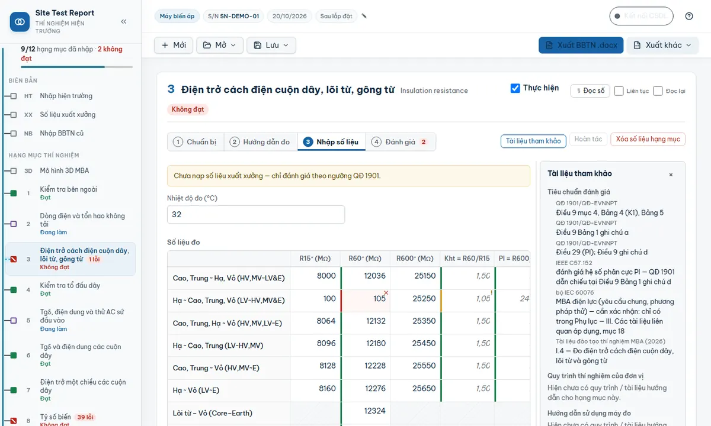

1. Bấm **Mới** → chọn **Máy biến áp** → trình khởi tạo 4 bước ([Mục 0](#0-muc-0-thong-tin-chung-va-cau-hinh)): chọn thiết bị, kiểm tra thông số, lý do – ngày – nhiệt độ, mẫu BBTN.
2. Mở từng hạng mục `1`…`12`: đọc **Hướng dẫn đo**, nhập ở **Nhập số liệu** (bàn phím, dán Excel, giọng nói, nạp file máy đo).
3. Xem **Đánh giá** của hạng mục: Đạt / ✕ Không đạt / ! Cần xem xét, kèm căn cứ QĐ 1901.
4. Nhóm **Kết quả**: `PL` đính kèm phụ lục → `↗` xem xu hướng → `Σ` **Điền kết luận tự động** rồi đọc, sửa.
5. **Xuất BBTN .docx**; **Lưu ▾** → *Lưu lên CSDL* (cần đăng nhập) hoặc *Lưu file .json*.

> **Lưu ý:** app tự lưu bản đang nhập trên trình duyệt của máy này. Muốn dùng trên máy khác: lưu CSDL hoặc file .json.

## Màn hình và thao tác chung

### Bố cục

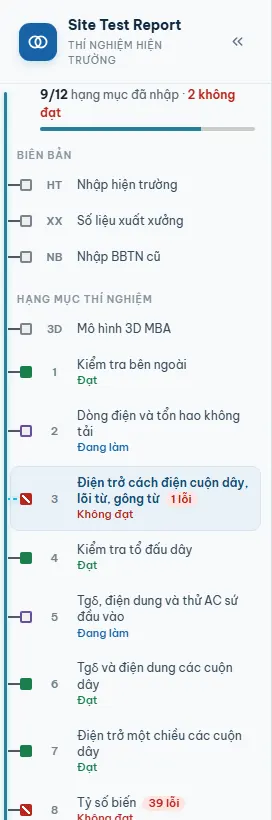

- **Thanh điều hướng** vẽ như sơ đồ một sợi: mỗi hạng mục là một ngăn lộ, **ký hiệu máy cắt** cho trạng thái — hở: chưa nhập; xanh: Đạt; vàng: Cần xem xét; đỏ gạch chéo: Không đạt.
- **«** hoặc **Ctrl+B** thu gọn thanh; kéo mép phải để đổi độ rộng. Hai nhóm cuối bấm tên nhóm để đóng / mở.
- **Thanh công cụ:** **Mới**, **Mở ▾** (CSDL / .json), **Lưu ▾** (CSDL / .json), **Xuất BBTN .docx**, **Xuất khác ▾** (bảng so sánh .xlsx).
- Muốn sửa thông tin chung: bấm **thanh thông tin biên bản** (S/N · ngày · lý do ✎) ở đầu trang.
- Trang dài: cuộn xuống hơn nửa màn hình thì góc phải dưới hiện nút tròn **↑** — bấm để về đầu trang.

### Bốn bước của mỗi hạng mục

| Bước | Có gì |
|---|---|
| **Chuẩn bị** | Việc cần làm trước khi đo (an toàn, thiết bị) |
| **Hướng dẫn đo** | Mục đích, điều kiện, **sơ đồ đấu dây có hình**, trình tự đo, lưu ý — tổng hợp QĐ 1901 Chương V, QT-KĐMBA, tài liệu đào tạo; nguồn từng ý ghi trong ngoặc |
| **Nhập số liệu** | Bảng nhập, nút nạp file máy đo, giọng nói, xu hướng tại ô |
| **Đánh giá** | Bảng so sánh: đo, quy đổi, tham chiếu, độ lệch, giới hạn, kết quả, căn cứ |

Khung **Tài liệu tham khảo** bên phải (màn hình ≥ 1100 px): điều khoản QĐ 1901, tiêu chuẩn dẫn chiếu, tài liệu trong thư viện. Bấm **×** để ẩn.

> **Lưu ý:** hướng dẫn trong app không thay thế sơ đồ, phương án an toàn và quy trình được đơn vị phê duyệt.

### Xu hướng tại ô

Ô có lịch sử đo trong CSDL (đã đăng nhập) hiện khung nhỏ dưới số: đường các lần đo, **XX / LĐ / KĐ ±%** (so với giá trị khởi đầu), **Trước ±%** (so với lần gần nhất), **Dự báo ⚠** khi xu hướng sắp chạm ngưỡng QĐ 1901; nền vàng khi vượt ngưỡng. Bấm **icon biểu đồ** ở góc trái khung → trang **Xu hướng** mở sẵn đúng máy (số chế tạo cột pha) và chuỗi số liệu của ô (vd R một chiều · HV · nấc 1); biểu đồ có thêm điểm **Biên bản đang nhập** (hình thoi — số đang nhập, đã quy đổi, chưa cần lưu CSDL); nút **← Về ô vừa xem** quay lại đúng ô.

### Nhập số, màu ô, hoàn tác

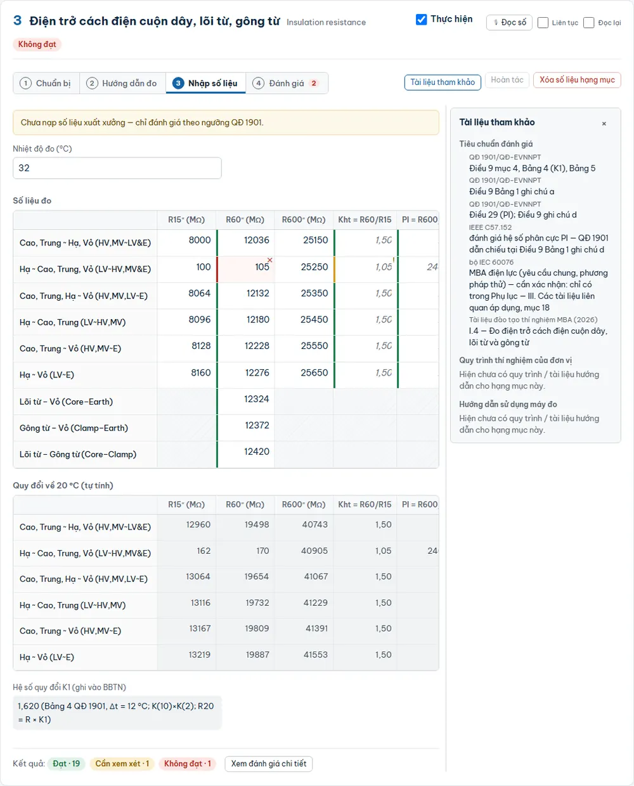

- Gõ số hoặc **dán bảng từ Excel** vào ô đầu; **Enter** xuống hàng cùng cột.
- **Ô xám**: tự tính (quy đổi 20 °C, Kht, PI…), vẫn gõ đè được.
- **Viền xanh** Đạt; **đỏ + ✕** Không đạt; **vàng + !** Cần xem xét. Rê chuột lên ô xem chi tiết và căn cứ.
- **Ô tô vàng** "Tự điền từ …": giá trị app điền sẵn (CSDL, test report, BBTN cũ, máy pha khác) — kiểm tra lại; sửa ô là bỏ tô.
- **Hoàn tác** / **Ctrl+Z** (ngoài ô nhập): đảo thao tác của hạng mục hiện tại. **Xóa số liệu hạng mục**: chỉ xóa hạng mục này.
- Bỏ tích **Thực hiện** ở đầu hạng mục: ẩn vùng nhập, không đánh giá, không ghi CSDL (số liệu vẫn giữ).

### Nhập bằng giọng nói

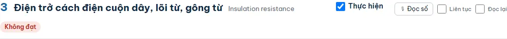

1. Bấm vào ô đầu, bấm **🎙 Đọc số**, cho phép micro (trang phải mở qua **https**; cần mạng).
2. Đọc số: “một trăm hai mươi lăm phẩy ba”, “không phẩy không bốn”, “2 phẩy 5”, “4500 mê ga” (đơn vị đọc kèm được bỏ).
3. Tích **Liên tục** để tự xuống ô dưới. Lệnh: **bỏ qua**, **lùi**, **xóa**, **dừng**.
4. **Biết đã nhập xong:** một tiếng **bíp cao**, rung ngắn (Android), ô **nháy xanh**; không hiểu: **hai tiếng bíp thấp**. Dòng **Nghe: “…” → giá trị** cho biết app hiểu thành số nào.
5. Tích **Đọc lại**: máy đọc “tên ô: số” (vd “R60: 4500”), micro tạm dừng khi máy nói.

## `HT` Nhập hiện trường

[Mở trang →](#app:field)

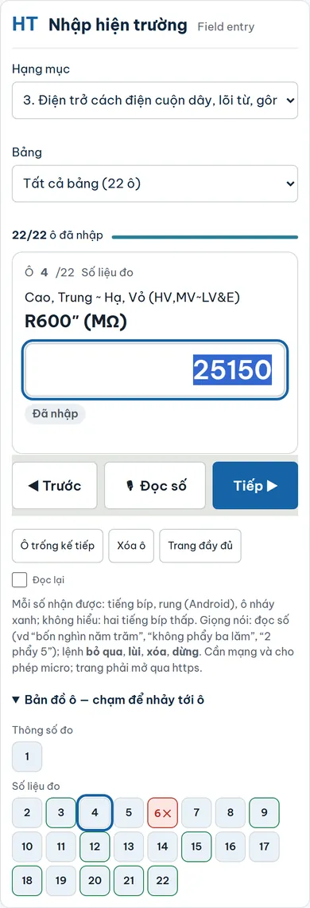

Một ô lớn mỗi lần, dùng một tay ngoài hiện trường. Mở từ menu hoặc nút **📱 Nhập từng ô** ở đầu hạng mục (màn hình nhỏ).

1. Chọn **Hạng mục**, **Bảng**. Chỉ có ô số cần nhập (ô tự tính, ô chữ nhập ở trang đầy đủ).
2. Gõ số → phím **Tiếp** / **Enter** sang ô kế; **◀ Trước** để lùi.
3. Dưới ô: đánh giá ngay (Đạt / ✕ / !, giá trị quy đổi, giới hạn) và tiến độ *x/y ô*.
4. **🎙 Đọc số**: đọc liên tục, tự sang ô kế, bàn phím ảo tự ẩn.
5. **Ô trống kế tiếp**; **Bản đồ ô** — chạm số để nhảy; **Thứ tự** theo hàng / theo cột (bảng theo pha: hết pha A rồi pha B).

## `0` Mục 0: Thông tin chung và cấu hình

Trình khởi tạo 4 bước, mở bằng **Mới** hoặc bấm thanh thông tin biên bản.

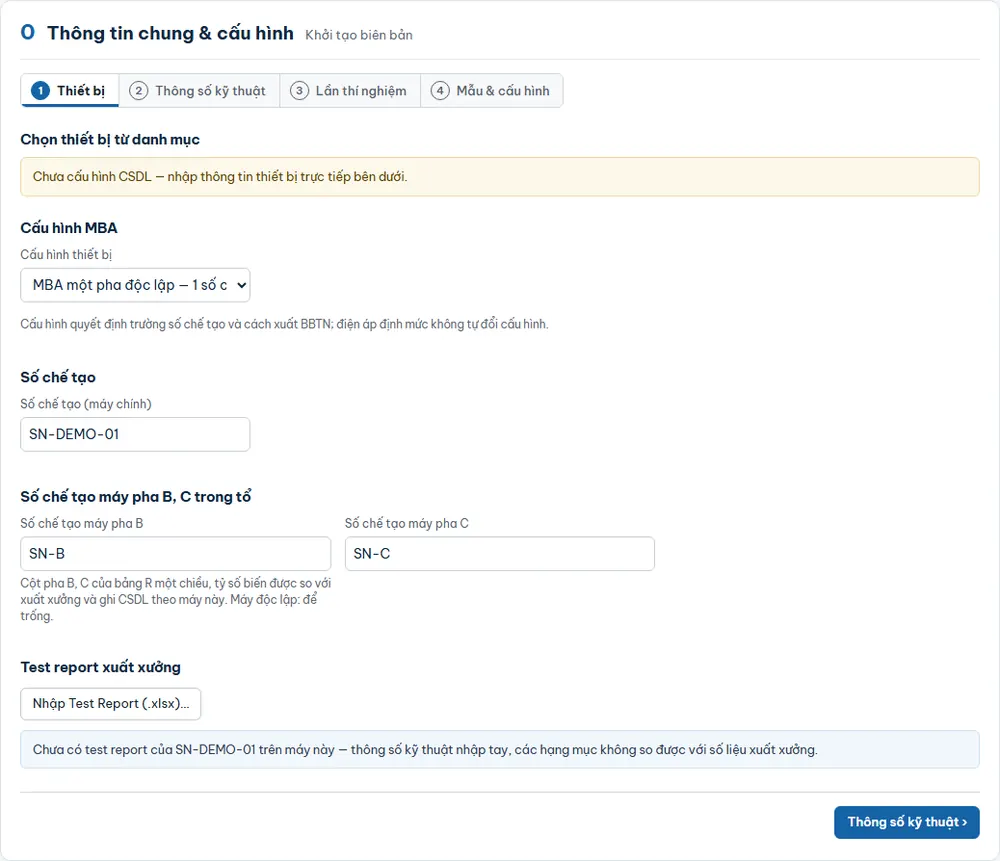

1. **Thiết bị** — đã đăng nhập: chọn **Trạm → Ngăn → Thiết bị** (tổ 3 máy 1 pha: chọn **Pha** hoặc **Cả tổ A+B+C**); thiết bị mới: **＋ Thiết bị mới trong ngăn này**. Chưa đăng nhập: chọn cấu hình, nhập số chế tạo. **Nhập Test Report (.xlsx)…** nạp file xuất xưởng.
2. **Thông số kỹ thuật** — app tự điền theo thứ tự: CSDL → test report → BBTN gần nhất → nhập tay. Ô tự điền tô vàng, ô thiếu tô đỏ. Có **Nhập ảnh nameplate…** (OCR). Chọn thiết bị từ CSDL thì app điền luôn **sứ xuyên** của máy (kiểu loại, hãng, số chế tạo theo vị trí 1.1 / 2.1 / N / 3.1 / 3.2; thiếu thì lấy BBTN gần nhất) và **chỉ danh biến dòng chân sứ**, số cuộn thứ cấp của BBTN gần nhất.
3. **Lần thí nghiệm** — lý do, ngày, nhiệt độ, độ ẩm; hạng mục thực hiện. *Sau sửa chữa/đại tu*: chọn có lấy số liệu lần này làm **giá trị khởi đầu mới** không (có lọc sấy dầu: cách điện cuộn dây; thay cuộn dây: mọi số liệu).
4. **Mẫu & cấu hình** — template BBTN, file xuất xưởng, phạm vi xuất, phụ lục, nhãn nấc, cách đo cuộn cao áp (A-N / A-Am), OLTC ở cuộn nào, số cuộn thứ cấp TI chân sứ. **Bắt đầu nhập số liệu →**.

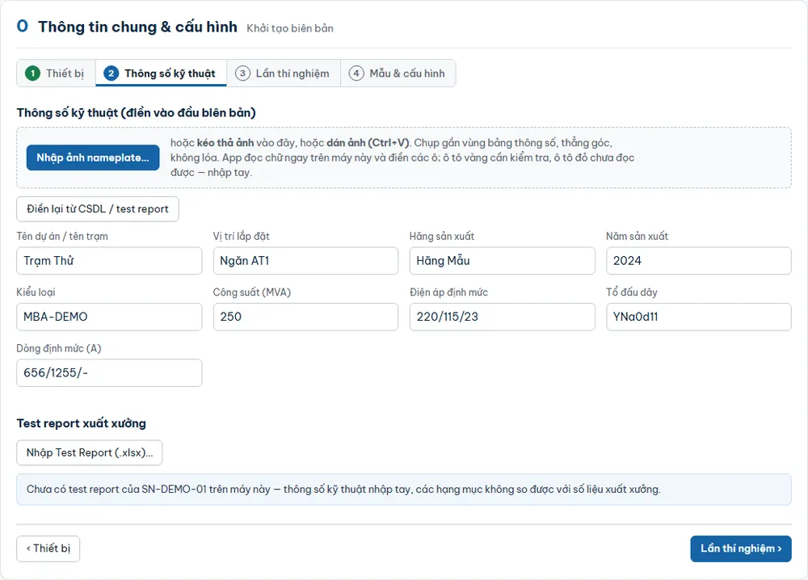

### Mẫu BBTN và số mục

- **Tổ 3 máy 1 pha** (thường 500 kV): mẫu theo pha **A / B / C** (một máy một BBTN; nhập S/N máy pha B, C để so giữa các pha) hoặc mẫu chung **3P**. Ở mẫu theo pha, bảng sứ và biến dòng chân sứ là của **máy đang lập**; sứ hạ áp có hai sứ **3.1, 3.2** (cột a, b). Mẫu **3P** xuất được **một BBTN chung** hoặc **tách BBTN riêng theo pha** (Mẫu & cấu hình → Phạm vi xuất BBTN; nhiều pha tải thành ZIP); khi tách, chọn **Số vòng quay OLTC trong BBTN từng pha**: cả hai chiều / chỉ tăng nấc / chỉ giảm nấc — áp chung cho 3 pha. BBTN từng pha giữ %Uđm không tải, mã hiệu / Uđm / Iđm / nhiệt độ từng sứ (hàng chèn thêm) và hệ số K riêng của sứ trung tính; không có R180 / R360 (mẫu theo pha chỉ R15, R60, R600). **MBA 3 pha 110–220 kV**: một S/N, một BBTN.
- Lý do *Sau lắp đặt*, *Sau sửa chữa/đại tu* dùng ngưỡng "MBA mới" của QĐ 1901; các lần khác dùng ngưỡng máy đã vận hành.

| Hạng mục | Mẫu theo pha, 110 | Mẫu 3P |
|---|---:|---:|
| Kiểm tra bên ngoài · Không tải · Cách điện · Tổ đấu dây · Sứ | 1 · 2 · 3 · 4 · 5 | 1 · 2 · 3 · 4 · 5 |
| tgδ cuộn dây · R một chiều · Tỷ số biến | 6 · 7 · 8 | 7 · 8 · 9 |
| OLTC · Độ ẩm · TI chân sứ · Ngắn mạch | 9 · 10 · 11 · 12 | 11 · 10 · 13 · 14 |

## `XX` Số liệu xuất xưởng

[Mở trang →](#app:factory)

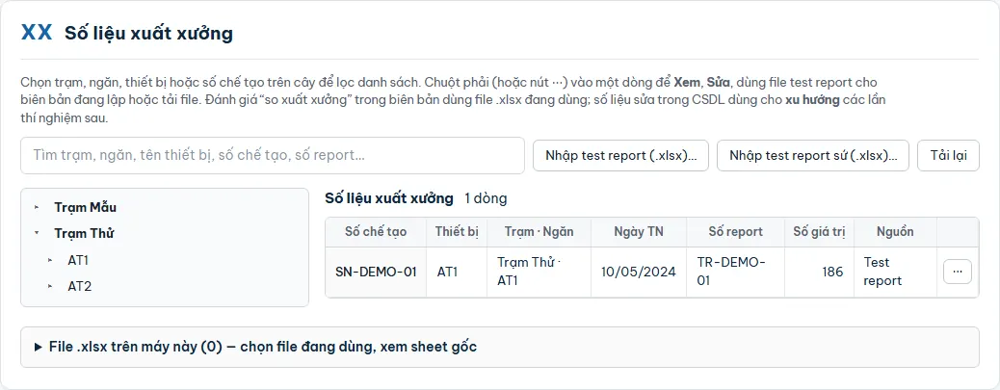

Số liệu xuất xưởng (FAT) lưu CSDL là **giá trị khởi đầu** để so sánh và xem xu hướng.

1. Cây **Trạm → Ngăn → Thiết bị → Số chế tạo** (cả sứ); ô **Tìm** không cần gõ dấu. Bấm nút trên cây để lọc.
2. **Nhập test report (.xlsx)…** (thanh công cụ hoặc chuột phải thiết bị) → chọn máy, trạm / ngăn → **Lưu**. File không ghi ngày: nhập tay.
3. **Chuột phải** một dòng: Xem số liệu · Sửa giá trị đo · Sửa số chế tạo · Gán / đổi trạm – ngăn · Dùng cho biên bản đang lập · Tải file · Xóa (Admin).
   - **Dùng cho biên bản đang lập**: tải file test report gốc; lần nhập không còn file gốc thì app **dựng lại từ số liệu đã lưu** của các máy cùng lần nhập (cùng ngày, số report) — đủ để so R một chiều, tỷ số HV:MV, MV:LV, cách điện, tgδ, sứ, BCT; thiếu điện áp nấc (tỷ số HV:LV), thông số chịu đựng sứ, tổn hao ngắn mạch. Mở biên bản (đã đăng nhập) mà máy chưa có số liệu xuất xưởng trên máy thì app **tự nạp** lần test report mới nhất trong CSDL; số liệu được lưu tạm trên máy để dùng khi mất mạng.
4. Chuột phải **ngăn**: *Khai tổ máy 3 pha* (thay máy một pha có ngày). Chuột phải **máy chính**: *Lịch sử vị trí lắp đặt*. Chuột phải **sứ / OLTC / TI**: *Thay … này*.
5. **Nhập test report sứ (.xlsx)…**: C1, tgδ sứ xuất xưởng làm giá trị khởi đầu cho xu hướng sứ.

> **Thiết bị chưa vận hành:** nhập test report trước, lưu CSDL. Khi lắp đặt xong, khởi tạo BBTN và chọn thiết bị — app tự lấy thông số và số liệu xuất xưởng.

## `NB` Nhập BBTN cũ

[Mở trang →](#app:importReport)

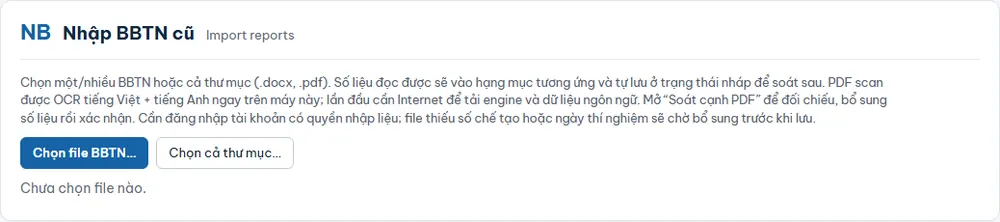

1. **Chọn file BBTN…** hoặc **Chọn cả thư mục…** (.docx mẫu PTC3/BM.01, .pdf có chữ, .pdf scan — OCR ngay trên máy).
2. Kiểm tra số chế tạo, ngày, **lý do** (lần *Sau lắp đặt* ghi **khởi đầu**), số biên bản, số ô số liệu.
   Cột **Trạm / ngăn**: app gợi ý ngăn theo tên trạm và vị trí lắp đặt ghi trên BBTN (vd "Máy biến áp AT1" → ngăn AT1); chọn lại nếu sai. Lưu CSDL sẽ gắn thiết bị vào ngăn này để lần sau chọn được ở bước ① (Trạm → Ngăn → Thiết bị). Thiết bị đã gắn ngăn thì giữ nguyên.
3. **Trùng** số chế tạo + ngày với CSDL hoặc file khác trong lô: không tự lưu — chọn **Ghi đè** hoặc **Lưu thành lần mới**.
4. PDF: **Soát cạnh PDF** (bản gốc bên trái, biểu mẫu bên phải) → nhập / sửa số liệu → **Đã soát** → **Lưu CSDL**.
5. **BBTN cũ theo pha (máy 1 pha 500 kV, PDF):** app nhận ra pha của máy ("Vị trí lắp đặt … (Pha A)"), đọc các bảng đã xóa bớt cột theo nhãn tiêu đề (cao áp "A", trung áp "Am | N", hạ áp "3.1 | 3.2", BCT "Pha A"), thông số kỹ thuật MBA và mọi sứ xuyên. Khi lưu CSDL, sứ được lưu thành thiết bị con của máy (vị trí, kiểu loại, hãng, loại cách điện) để lần sau tự nạp.
6. **Số liệu xuất xưởng:** app chỉ so sánh với test report của **đúng số chế tạo** của biên bản (file trên máy, hoặc tự tìm trong CSDL theo số chế tạo); không dùng test report của máy khác dù cùng chủng loại. Máy chưa có test report: tích **Chưa có số liệu xuất xưởng** ở dòng của file (hoặc ở *Thông tin chung → Mẫu & cấu hình*) — app không so với XX, không tìm trong CSDL; giá trị khởi đầu lấy theo lần sau lắp đặt / lần trước.

## `3D` Mô hình 3D MBA

[Mở trang →](#app:model3d)

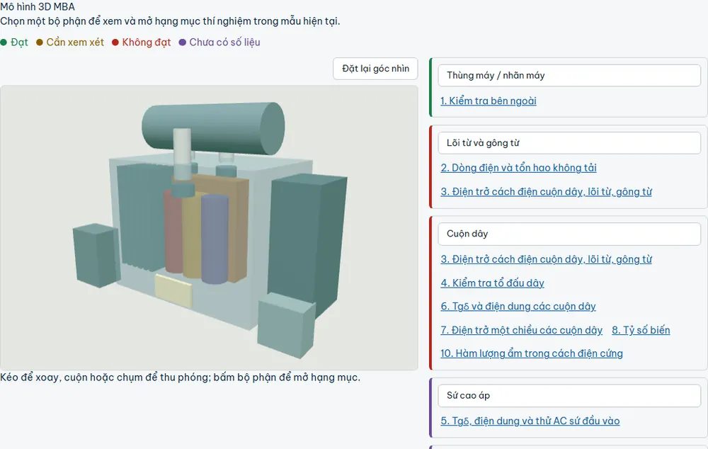

Kéo để xoay, cuộn / chụm để thu phóng; bộ phận tô màu theo kết quả. Bấm bộ phận để mở hạng mục.

- Sứ bố trí như trên nắp máy: **HV** A, B, C dọc mép sau, **N** cuối mép sau bên phải; **MV** Am, Bm, Cm hàng giữa; **LV** a, b, c ở đầu trái.
- **Bấm một sứ** (hoặc nút pha A · Am · N · a… trong danh sách bên phải) → mở mục 5 ở bước Nhập số liệu, con trỏ đặt sẵn vào ô tgδ C1 của pha đó. Gạch dưới nút pha có màu theo kết quả của sứ đó.
- Mẫu 3 máy 1 pha: sứ N chung cho N của từng máy — bấm vào sẽ hiện danh sách máy A / B / C để chọn.

## Các hạng mục thí nghiệm

Mỗi hạng mục có đủ 4 bước; phần dưới chỉ ghi điều riêng. Ngưỡng chi tiết xem bước **Đánh giá** hoặc trang [Bộ tiêu chí](#tc-bo-tieu-chi-danh-gia); trình tự đo xem bước **Hướng dẫn đo**.

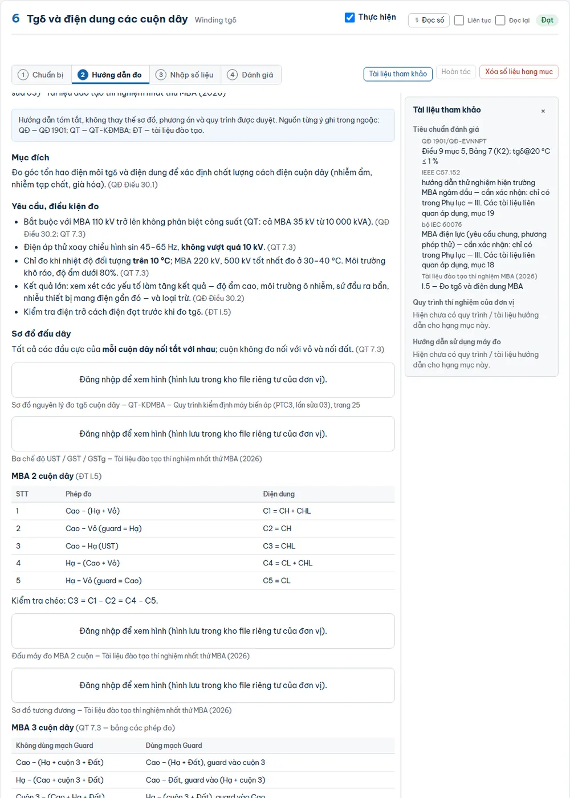

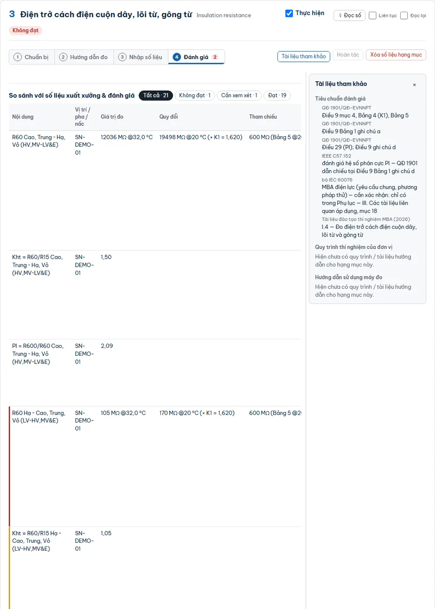

## `1` Mục 1: Kiểm tra bên ngoài

[Mở →](#app:visual) Ghi tình trạng vỏ, sứ, dầu, phụ kiện; chọn **Đạt / Không đạt**. Căn cứ Điều 9 Bảng 1.

## `2` Mục 2: Dòng điện và tổn hao không tải

[Mở →](#app:noload) Nhập U, I0, P0 theo phép đo (điện áp thấp trên cuộn hạ / cao áp, điện áp định mức). App tính I0 %, P0 hiệu chỉnh và so sánh giữa pha biên (Điều 34). Đo **trước** R một chiều và cách điện.

## `3` Mục 3: Điện trở cách điện

[Mở →](#app:ir)

- Nhập **nhiệt độ đo**, R15, R60, R600, lõi / gông từ. App quy R60 về 20 °C (K1), tính Kht, PI, so Bảng 5 / xuất xưởng.
- **So với lịch sử đo:** đã đăng nhập, app tải các lần đo trước của máy; mỗi đại lượng có dòng "Xu hướng …" so với **giá trị khởi đầu** (sau sửa chữa → xuất xưởng → sau lắp đặt → lần sớm nhất) và lần trước. Vượt tiêu chí: khung cảnh báo đỏ đầu mục kèm hướng xử lý. Áp dụng cho R60, tgδ, điện dung cuộn dây, C1 / tgδ sứ, P0.
- Ô có **Dự báo ⚠ tháng/năm**: xu hướng có ý nghĩa thống kê, dự kiến chạm ngưỡng trong 3 năm.

## `4` Mục 4: Kiểm tra tổ đấu dây

[Mở →](#app:vector) Nhập tổ đấu dây đo được; app đối chiếu nameplate (Điều 32).

## `5` Mục 5: Sứ đầu vào

[Mở →](#app:bushing)

- Chọn phía, loại cách điện (OIP, RIP…), **Đã lắp / Chưa lắp**, nhiệt độ; nhập C1, tgδ1, C2, tgδ2 và thử AC (nếu có).
- **Cách quy đổi về 20 °C**: bảng QĐ 1901, HD hãng (Hitachi RIP) hoặc nhập K — bảng hệ số ở trang [Hệ số quy đổi sứ](#k-he-so-quy-doi-su).
- **Thêm file .xlsx…** nạp test report sứ (gộp theo S/N sứ) để so với hãng.
- **Đề mục cột sửa được** (ô ở hàng tiêu đề bảng): vd hạ áp **3.1 / 3.2** hoặc **LV1 / LV2**. Bảng quy đổi 20 °C, bảng thử AC và BBTN xuất ra dùng cùng nhãn. Để trống để về nhãn mặc định.
- Mẫu theo pha: cột a, b của bảng hạ áp là hai sứ 3.1, 3.2 của máy; cột c dự phòng.

## `6` Mục 6: Tgδ và điện dung cuộn dây

[Mở →](#app:wtgd)

- Nhập nhiệt độ, tgδ, C, điện áp, sơ đồ đo. App quy tgδ về 20 °C bằng K2 (Bảng 47).
- **tgδ20 ≤ 1 %**: Đạt, không cần so giá trị khởi đầu. **> 1 %**: tăng ≤ 30 % so với khởi đầu; không có khởi đầu thì tham khảo **Bảng 46** (quy về cột gần nhất bằng K2).

> **Lưu ý:** ghi chú sau Bảng 47 QĐ 1901 in "÷ K1" là nhầm — đúng là **K2**; app luôn dùng K2.

## `7` Mục 7: Điện trở một chiều

[Mở →](#app:dcr)

- Mỗi cuộn dây (cao, trung, hạ áp) có ô **Nhiệt độ chung cuộn … (°C)** và ô **Nhiệt độ đo** riêng cho từng pha (A-N, B-N, C-N…) — mỗi pha đo vào thời điểm khác nhau. Pha để trống thì dùng nhiệt độ chung của cuộn. Nhập R theo nấc, pha.
- Ô **Quy đổi R về nhiệt độ (°C)** ở đầu mục: mặc định 75; nhập nhiệt độ khác (vd 20) thì cột quy đổi, BBTN đổi theo.
- Cột **… @75 °C** (nền xám, tự tính; tên cột theo nhiệt độ quy đổi đã chọn) ngay sau mỗi cột pha: R_T = R·(235 + T)/(235 + t), t là nhiệt độ của pha đó (hoặc nhiệt độ chung của cuộn). BBTN Word ghi giá trị quy đổi này vào bảng R một chiều và ghi **nhiệt độ quy đổi**: mẫu theo pha “t = 28 oC, quy đổi về 75 oC”, mẫu 3 pha đề mục “… qui đổi về 75 oC”.
- So sánh với xuất xưởng vẫn quy về nhiệt độ của số liệu xuất xưởng; CSDL lưu giá trị chuẩn @75 °C.
- Mẫu 3 máy 1 pha: ô pha và ô chung đều trống thì lấy nhiệt độ đo của máy pha đó.
- Dòng “t = … oC” của BBTN ghi nhiệt độ chung của cuộn; chưa nhập nhiệt độ chung thì ghi các nhiệt độ pha, vd “22; 30; 41”. Pha thiếu nhiệt độ: ô đó không ghi vào BBTN (báo trong danh sách ô chưa ghi).
- Độ lệch giữa các pha ΔR(A,B,C) tính trên giá trị đã quy về 75 °C.
- Nhập BBTN cũ (NB): số trong bảng được hiểu là R đã quy đổi về nhiệt độ ghi trên biên bản (“quy đổi về … oC”, không ghi → 75 °C); app lấy lại nhiệt độ quy đổi đó và đổi về giá trị đo theo nhiệt độ đo; không có nhiệt độ đo thì coi là giá trị quy đổi và cảnh báo.
- App tính ΔR giữa pha, so xuất xưởng (≤ 2 %).
- Nấc trung gian **9b, 9c** chạy bypass khi chuyển nấc (vận hành dùng 9a) nên không có trong bảng R một chiều; nấc 9a so với nấc 9A xuất xưởng. Hàng 9b, 9c trong BBTN để trống.
- **Nhập file Haefely 2293…** (CSV / BIN): chọn pha, nấc, có quy đổi nhiệt độ hay không.
- **BBTN riêng máy pha A / B / C**: **Bổ sung số liệu pha … từ CSDL** lấy lần đo **cùng đợt** (≤ 30 ngày, sửa được) của 2 máy còn lại để so giữa các pha; ô bổ sung không ghi vào lần thí nghiệm này.

## `8` Mục 8: Tỷ số biến

[Mở →](#app:ratio) Nhập tỷ số theo nấc, pha, cặp cuộn; app tính ΔK so nameplate và giữa các pha (≤ 0,5 %). Có nạp Haefely 2293 và bổ sung pha từ CSDL như mục 7.

## `9` Mục 9: OLTC

[Mở →](#app:oltc) Nhập kiểu, dải nấc; **nạp file chụp sóng Haefely 2293** để vẽ dạng sóng (đưa vào phụ lục). Đánh giá theo hướng dẫn nhà sản xuất (Điều 37).

## `10` Mục 10: Độ ẩm cách điện cứng

[Mở →](#app:moisture) Nhập % ẩm (FDS / PDC). < 2,2 % khô; 2,2–3,7 % trung bình; 3,7–4,8 % ẩm; > 4,8 % ẩm cao (Điều 28).

## `11` Mục 11: Biến dòng chân sứ

[Mở →](#app:bct)

- Nhập cách điện, cực tính, tỷ số, R một chiều, đặc tính V-A theo phía, pha, lõi.
- **Chỉ danh sửa được**: đề mục cột (vd "Pha A" → "CT 1.1", dùng chung các bảng cùng phía) và nhãn hàng (cuộn thứ cấp, đầu phân dòng vd "1S1-1S2"). BBTN xuất ra ghi đúng chỉ danh đã sửa.
- **Tải XML CPC 100…** hoặc **Nhập Megger MRCT (.pdbxml, PDF)…**: gán phía / pha / lõi, kiểm tra điểm khuỷu trước khi xác nhận.

## `12` Mục 12: Thí nghiệm ngắn mạch MBA

[Mở →](#app:shortCircuit)

- Nhập theo cặp cuộn, nấc, pha: U thử (V / kV), I, P, f, Un, In, nhiệt độ. App quy Uk = U/Un × In/I, Pk × (In/I)².
- Đánh giá QĐ 1901 Điều 35 và QĐ 1387: Uk, Pk so Test Report / nhãn máy / Uk ban đầu, lệch giữa pha. Dòng thử < 25 % In hoặc sai tần số: Cần xem xét. Ngưỡng chỉnh được ở [Bộ tiêu chí](#tc-bo-tieu-chi-danh-gia).
- Xuất BBTN: là mục cuối của biên bản (12.1–12.3), không phải phụ lục.

## `PL` Phụ lục BBTN

[Mở trang →](#app:appendix)

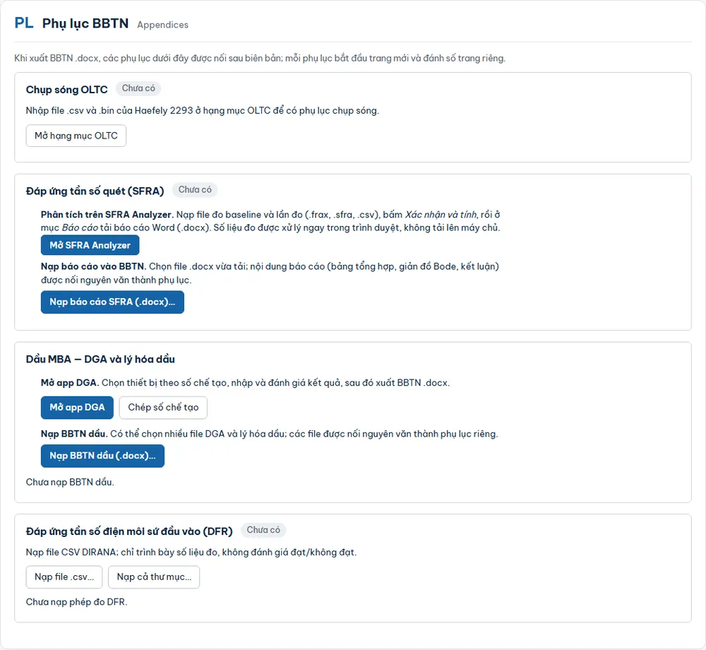

| Phụ lục | Cách đưa vào |
|---|---|
| Chụp sóng OLTC | Nạp file Haefely 2293 ở mục 9 |
| SFRA | **Mở SFRA Analyzer** → tải báo cáo Word → **Nạp báo cáo SFRA (.docx)…** |
| Dầu MBA (DGA, lý hóa) | **Mở app DGA** (có **Chép số chế tạo**) → xuất BBTN dầu → **Nạp BBTN dầu (.docx)…** → **Nối vào BBTN** |
| DFR sứ (DIRANA) | **Nạp file .csv…** / **Nạp cả thư mục…** (CSV DIRANA, cả bản 4.x) → chọn phía, pha (tên phép đo dạng `bushing500_A` được nhận tự động); trình bày tham khảo |

## `↗` Xu hướng

[Mở trang →](#app:trend)

1. Chọn thiết bị (có thể **Gồm sứ / OLTC**), hạng mục, đại lượng, sơ đồ / nấc.
2. Đồ thị các lần đo (giá trị quy về 20 °C / 75 °C), mốc khởi đầu, **ngưỡng QĐ 1901** tính từ giá trị khởi đầu.
3. **Dự báo** (1 / 3 / 5 / 10 năm): đường dự báo, khoảng 95 %, bảng xu hướng (Mann–Kendall, tốc độ / năm, ngày dự kiến chạm ngưỡng). Chỉ để theo dõi, không thay đánh giá tổng thể.

## `Σ` Tổng hợp và kết luận

[Mở trang →](#app:summary)

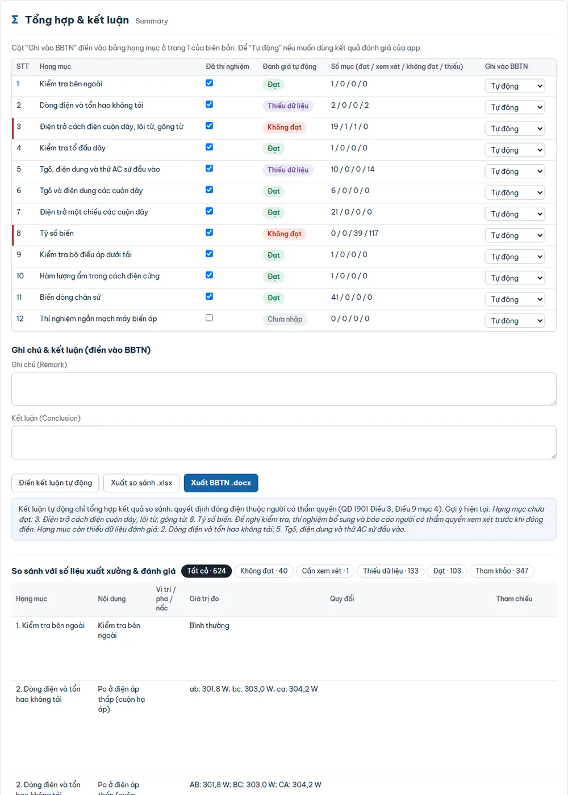

1. Rà bảng hạng mục (Đạt / Không đạt / Cần xem xét / Thiếu dữ liệu) và bảng so sánh chi tiết.
2. **Điền kết luận tự động** → đọc lại, sửa theo thực tế. Kết luận nêu cả ngưỡng đơn vị đã chỉnh khác QĐ 1901.
3. **Xuất BBTN .docx** / **Xuất so sánh .xlsx** (có cột tiêu chuẩn dẫn chiếu).

> **Lưu ý:** không để kết luận tự động thay phán đoán kỹ thuật; xuất DOCX xong chưa có nghĩa đã lưu CSDL.

## `DB` Cơ sở dữ liệu (CSDL)

[Mở trang →](#app:db)

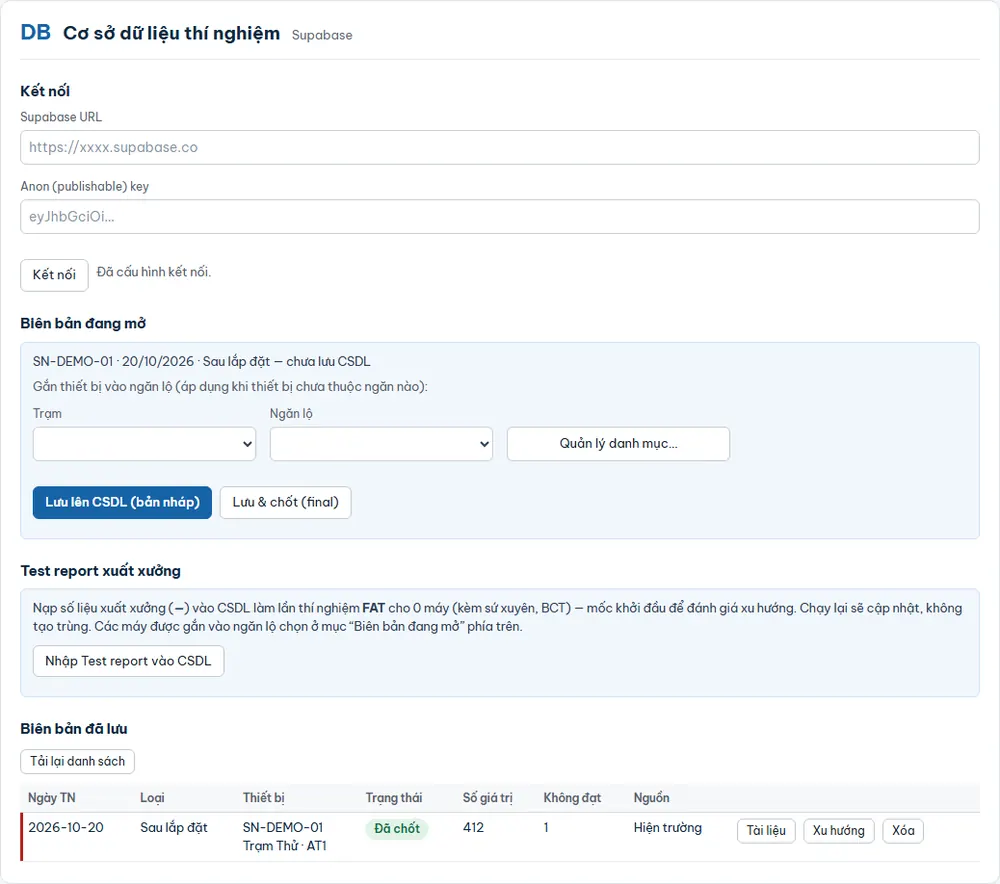

- **Đăng nhập** (email hoặc Google). Tài khoản mới là `viewer` (chỉ xem); Admin cấp `editor` để lưu, `admin` để quản trị.
- **Lưu lên CSDL (bản nháp)** · **Lưu & chốt (final)** · **Lưu thành biên bản mới** (tách khỏi phiên đang mở).
- **Biên bản đã lưu**: **Mở**, **Tài liệu**, **Xu hướng**, **Xuất BBTN**, **Xóa**; BBTN PDF có **Mở cùng PDF**.

> **Lưu ý:** không nhập `service_role` key vào app; chỉ dùng anon / publishable key.

## `≡` Trạm – Ngăn – Thiết bị

[Mở trang →](#app:catalog) Danh mục trạm, ngăn, thiết bị (Admin thêm / sửa). Thiết bị con (sứ, OLTC, TI) đi theo máy chính. Trình khởi tạo BBTN và trang `XX` dùng danh mục này.

## `TC` Bộ tiêu chí đánh giá

[Mở trang →](#app:criteria)

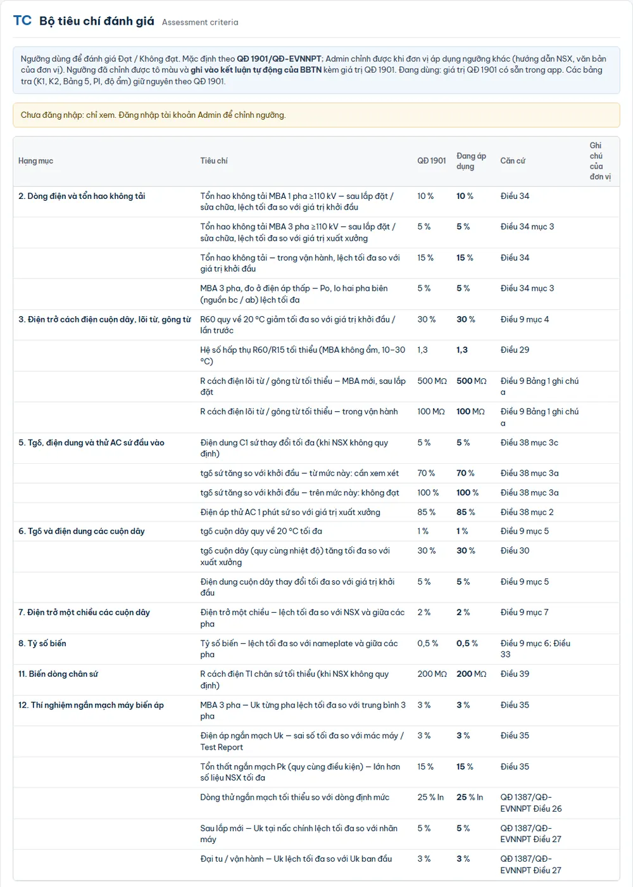

- Mỗi ngưỡng: giá trị **QĐ 1901**, giá trị **đang áp dụng** (Admin chỉnh khi có văn bản / HD nhà sản xuất), căn cứ, ghi chú. Ngưỡng khác QĐ 1901 tô màu và ghi vào kết luận.
- **Bảng tra tiêu chuẩn**: hạng mục → điều khoản QĐ 1901 → IEC / IEEE mà QĐ 1901 dẫn chiếu; dòng **cần xác nhận** là tiêu chuẩn chỉ có trong danh mục Phụ lục III của QĐ. App không lấy ngưỡng từ các tiêu chuẩn này.

## `K` Hệ số quy đổi sứ

[Mở trang →](#app:kconf)

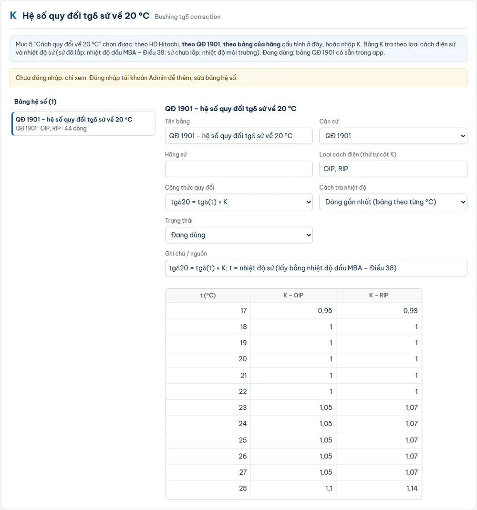

Chọn bảng QĐ 1901 hoặc bảng của hãng; Admin thêm / sửa / nhập từ Excel. Ở mục 5 chọn bảng trong **Cách quy đổi về 20 °C**.

## `TV` Thư viện tài liệu

[Mở trang →](#app:standards) Tiêu chuẩn, quy trình đơn vị, hướng dẫn máy đo (file trong kho riêng tư). Lọc theo loại, hạng mục; **Mở file**. Admin thêm / sửa / nhập danh mục Excel. Tài liệu hiện ở khung **Tài liệu tham khảo** của hạng mục liên quan.

## `HD` Cấu hình hướng dẫn đo

[Mở trang →](#app:guidecfg)

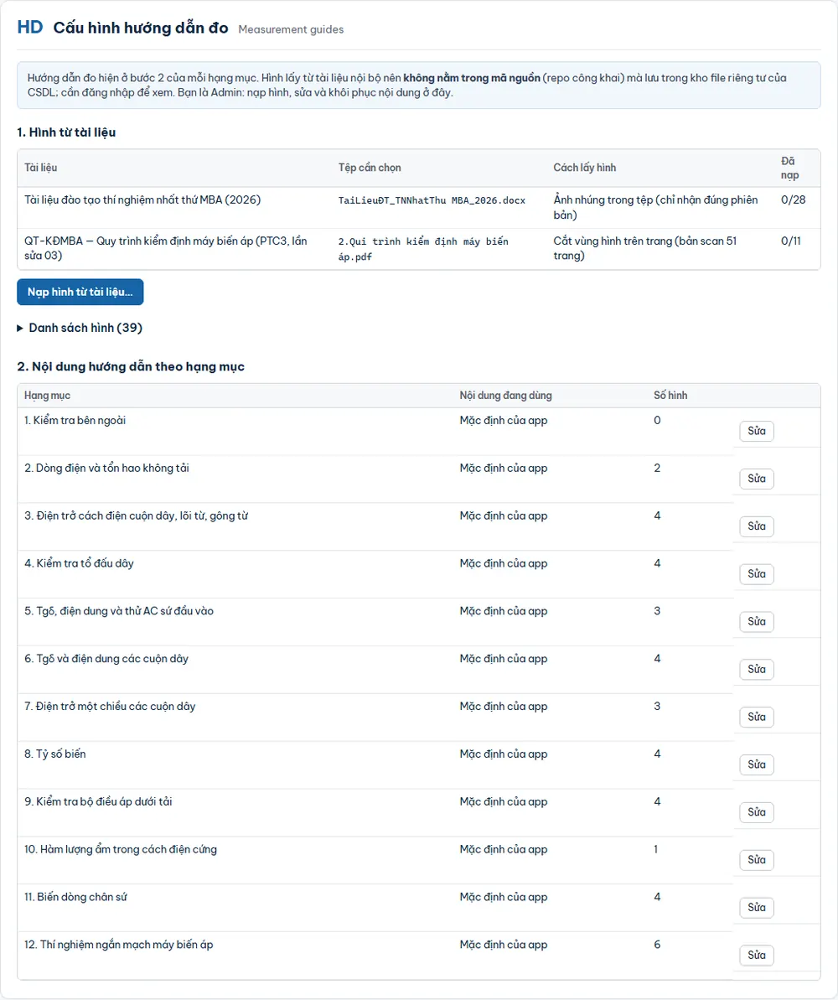

Hình sơ đồ trong **Hướng dẫn đo** lấy từ tài liệu nội bộ nên **không nằm trong mã nguồn** — lưu ở kho file riêng tư của CSDL, cần đăng nhập để xem.

1. **Nạp hình từ tài liệu…** (Admin): chọn cùng lúc *TaiLieuĐT_TNNhatThu MBA_2026.docx* và *2.Qui trình kiểm định máy biến áp.pdf* (51 trang). App tách ảnh / cắt vùng trang ngay trên máy rồi lưu. Ảnh .docx chỉ nhận đúng phiên bản tài liệu.
2. **Danh sách hình**: ảnh thu nhỏ, nguồn, hạng mục dùng, *Đã nạp / Chưa nạp*.
3. **Nội dung theo hạng mục**: *Mặc định* hay *Đơn vị đã chỉnh*. **Sửa** mở ô soạn Markdown có xem trước (`### Tiêu đề`, `1.` / `-`, `**đậm**`, bảng, hình ``, **Chèn ảnh…**); **Khôi phục mặc định** bỏ nội dung đơn vị.

## Lỗi thường gặp

| Thông báo | Cách xử lý |
|---|---|
| `Chưa có template BBTN` / `Không tìm thấy template tùy chỉnh` | Nạp template .docx ở bước ④ Mẫu & cấu hình |
| `Số chế tạo không có trong file xuất xưởng` | Chọn file khác hoặc kiểm tra S/N, cột pha |
| `Template có … bảng … vị trí điền có thể lệch` | Kiểm tra đúng template / mẫu trước khi phát hành |
| `Không đọc được file …` / `Lỗi đọc file` | Kiểm tra loại file, sheet, bố cục; hỏi Admin |
| `Trình duyệt chưa cho dùng micro` | Bấm ổ khóa trên thanh địa chỉ → cho phép micro; trang phải https |
| `Nhận dạng giọng nói cần có mạng` | Kiểm tra mạng, bấm Đọc số lại |
| `Đăng nhập để lưu…` / `Bạn chưa lưu được lên CSDL…` | Đăng nhập; vai trò chỉ xem thì nhờ Admin cấp quyền |
| `Đã xuất file nhưng chưa lưu được vào CSDL` | File đã tải; kiểm tra mạng / quyền rồi lưu lại |
| `Chưa chạy migration …` | Admin chạy migration được nêu trên Supabase |

> **Trước khi tải lại trang khi đang lỗi:** **Lưu file .json** để giữ số liệu nhập dở; ghi lại nguyên văn thông báo khi báo Admin.

## Bảo vệ dữ liệu

- Không đưa BBTN thật, S/N thật, tên trạm, file máy đo, tài liệu nội bộ lên repo công khai; ảnh trong hướng dẫn dùng số liệu giả.
- Không gửi key, thông tin tài khoản trong ảnh chụp; không dùng `service_role` key trong trình duyệt.
- CSDL và file .json là hai cách lưu riêng; sau **Lưu & chốt**, kiểm tra trạng thái trong danh sách.

## Tham chiếu

- [README dự án](../README.md) · [Kiến thức dự án](KIEN_THUC.md) · [Quy tắc agent](../AGENTS.md) · [Bảng phân công](PHAN_CONG.md)
- Mã: [giao diện](../js/ui/app.js) · [CSDL](../js/ui/db-ui.js) · [schema MBA](../js/domain/types/mba/schema.js) · [quy đổi và ngưỡng QĐ 1901](../js/domain/qd1901.js)
